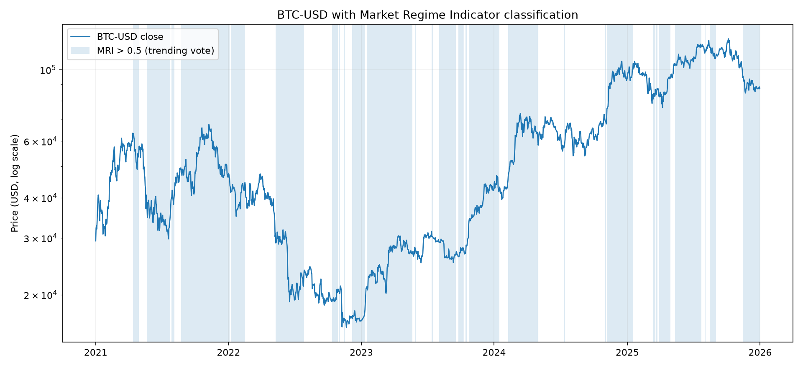
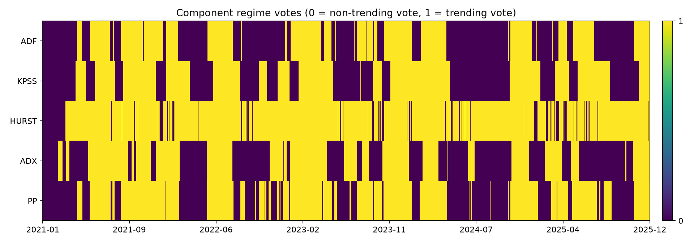

# Market Regime & Trend Research

[](https://github.com/soulidisath/market-regime-trend-research/actions/workflows/generate-example-figures.yml)

Personal research project exploring **trend-signal ensembles**, **market-regime classification**, cross-asset parameter tuning, and sensitivity to alternate historical price paths.

The repository is a cleaned presentation of exploratory work developed while studying systematic trading. It is **not production trading infrastructure** and it does not claim that the methods produce persistent alpha.

## Research questions

- Can several trend indicators be combined into a more stable composite signal?
- Can their parameters and relative weights be tuned across several assets rather than one price series alone?
- Can unit-root, long-memory, and directional-strength measures help separate persistent/trending periods from more mean-reverting periods?
- How sensitive are fixed configurations to the ordering of historical price moves?

## What is implemented

### 1. Trend-signal ensemble and parameter search

`src/trend_ensemble.py` contains a cleaned version of the original TPI research framework. It:

- combines multiple directional trend indicators into a composite signal;
- evaluates simple long/short backtests with `vectorbt`;
- compares configurations using drawdown, Sharpe, Sortino, Omega ratio, profit factor, and win rate;
- tunes the **indicator parameters of a chosen model set** against the mean score across multiple datasets;
- separately searches **ensemble weights** across multiple datasets with Optuna;
- supports parallel cross-asset evaluation with **Dask**; and
- evaluates fixed configurations on permuted OHLC paths as a sensitivity exercise.

The legacy research randomly sampled different indicator subsets as well as their parameters. In the cleaned version, the model subset is chosen explicitly when constructing `TrendEnsemble`, which makes each experiment easier to reproduce and explain.

The underlying indicator implementations are in `src/indicators.py`. Several were adapted from public TradingView indicator ideas; links to the original scripts are retained in the relevant docstrings rather than presenting every formula as original work.

#### Historical research visualization

The figure below is a saved output from the original exploratory TPI work. The upper panel shows price with changes in the aggregate directional state; the lower panel shows the individual indicator votes through time.


This image is retained as a historical research artifact. The cleaned code in this repository preserves the underlying ensemble and tuning ideas, but it is **not claimed to reproduce this legacy figure bit-for-bit**.

### 2. Market Regime Indicator (MRI)

`src/market_regime.py` combines five binary regime measures:

- Augmented Dickey-Fuller (ADF)
- KPSS
- Phillips-Perron
- rolling Hurst estimate
- Average Directional Index (ADX)

Their votes are averaged into a simple regime score. In these experiments, values above `0.5` are treated as a trending regime and values at or below `0.5` as a more mean-reverting regime. A custom heuristic score was used to compare parameter sets across several assets.

**Implementation note:** the original exploratory notebook used `nolds.mfhurst_b` for the Hurst component. The cleaned portfolio module uses a small, transparent rescaled-range estimator instead because the old dependency is brittle in clean environments. The regime-classification idea is preserved, but the cleaned implementation is not intended to be bit-for-bit identical to the notebook.

### 3. Monte Carlo path permutations

The trend framework includes an OHLC permutation routine that separately shuffles inter-bar and intra-bar log-return components before reconstructing synthetic price paths. I used this as a **sensitivity test**: does a fixed configuration remain reasonable when the temporal ordering of the observed moves is changed?

This should not be confused with genuine out-of-sample validation.

## Reproducible BTC-USD regime example

`examples/btc_usd_demo.py` downloads daily BTC-USD OHLC data with `yfinance`, applies a **fixed** representative MRI parameter set, and generates the two diagnostics below. The example does not optimize its parameters on BTC-USD immediately before plotting.

### Regime classification over price



Background shading marks periods for which the combined regime score is above `0.5`. The chart is a diagnostic view of the classifier, not a trading-performance chart.

### Component regime votes



Each row shows one binary component vote through time. The purpose is to make the construction of the aggregate MRI visible rather than treating it as a black box.

Run the regime example from the repository root:

```bash
python examples/btc_usd_demo.py
```

A second script, `examples/trend_ensemble_demo.py`, generates a clean fixed-parameter visualization of the trend-ensemble architecture without tuning the parameters on BTC-USD immediately before plotting.

```bash
python examples/trend_ensemble_demo.py
```

The parameter and weight searches are available separately for research experiments. A typical sequence is:

```python
from src.trend_ensemble import DEFAULT_MODELS, TrendEnsemble

ensemble = TrendEnsemble(DEFAULT_MODELS)
best_params, parameter_score = ensemble.optimize_parameters(training_datasets, n_trials=100)
best_weights, weight_score = ensemble.optimize_weights(training_datasets, n_trials=100)
```

Any such search should be evaluated on separate untouched data if the purpose is to make a claim about generalization. Cross-asset training by itself is not out-of-sample validation.

## Repository structure

```text
.
├── .github/
│   └── workflows/
│       └── generate-example-figures.yml
├── README.md
├── requirements.txt
├── examples/
│   ├── README.md
│   ├── btc_usd_demo.py
│   ├── trend_ensemble_demo.py
│   └── output/
│       ├── btc_regime_components.png
│       └── btc_regimes.png
└── src/
    ├── __init__.py
    ├── indicators.py
    ├── market_regime.py
    └── trend_ensemble.py
```

## Running the code

Create a virtual environment and install the full research dependencies:

```bash
python -m venv .venv
source .venv/bin/activate  # Windows: .venv\Scripts\activate
pip install -r requirements.txt
```

The modules expect OHLC data in a pandas DataFrame with lowercase columns such as `open`, `high`, `low`, and `close`.

`TA-Lib` is used by some trend-indicator experiments and may require platform-specific installation support. The BTC-USD regime example itself does not require `TA-Lib`, Optuna, Dask, or `vectorbt`.

## Important limitations

This work was exploratory. In particular:

- optimization on historical data can overfit;
- optimizing one configuration across several assets is not automatically out-of-sample validation;
- the Monte Carlo procedure is a robustness/sensitivity exercise, not independent future evidence;
- the simple backtest helper does not include transaction costs by default;
- the multi-metric research score is a heuristic comparison device rather than a theoretically optimal objective;
- regime labels are based on heuristic combinations of statistical and technical measures rather than a formally identified latent-state model; and
- no result in this repository should be interpreted as a claim of live or repeatable trading profitability.

Those limitations are part of the point of the project: the goal was to test ideas, understand failure modes, and make the research process more systematic.
